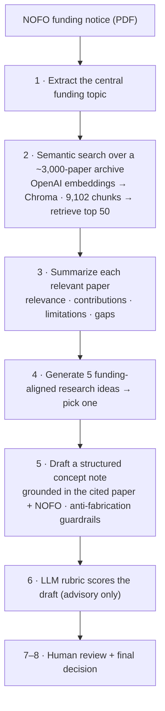
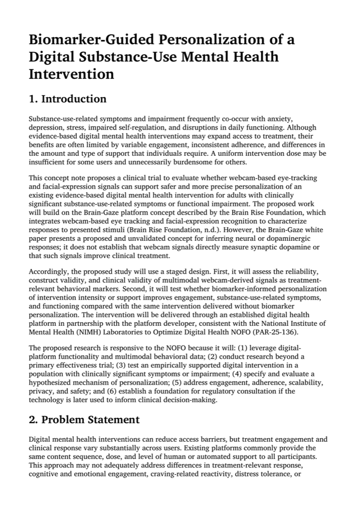
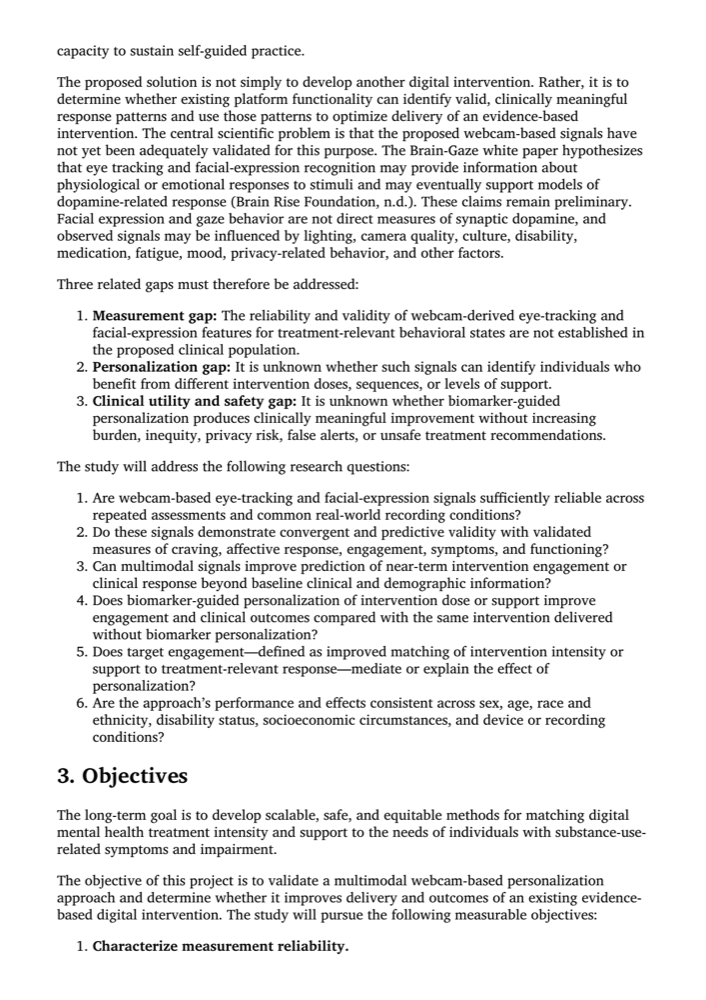

# AI for Research Proposal Automation — RAG Pipeline

> A Retrieval-Augmented Generation (RAG) system that helps a university research office turn a
> federal **Notice of Funding Opportunity (NOFO)** into a first-draft grant concept note — a task
> that normally takes **110–140 hours** — in minutes, with a human kept firmly in the loop.

**JHU GenAI & Agentic AI — Project 2** · Low-Code track · built in Google Colab

### 📂 What to look at
- **[`research_proposal_rag.ipynb`](research_proposal_rag.ipynb)** — the executed notebook (prompts + code + outputs). *GitHub renders it in your browser — no setup needed.*
- **[`Research_Proposal_First_Draft.pdf`](Research_Proposal_First_Draft.pdf)** — the AI-generated 10-page concept note (the deliverable).

---

## 🧭 How it works

## 📊 Results at a glance

| Papers in archive | Chunks embedded | Retrieved | Judged relevant | Output |
|:---:|:---:|:---:|:---:|:---:|
| ~3,000 | **9,102** | top 50 | **11 papers** | a 10-page concept note |

**Extracted funding topic:** *“Digital mental health interventions”*
**Advisory rubric score:** Innovation **4** · Significance **4** · Approach **3** · Investigator Expertise **1\*** · Overall **3**
\*Scored 1 *honestly* — a concept note contains no investigator biosketches, so the evaluator flagged "insufficient info" rather than inventing qualifications.

## 📄 The generated deliverable

From a funding notice, the pipeline produced a complete, structured grant concept note —
*“Biomarker-Guided Personalization of a Digital Substance-Use Mental Health Intervention”* — mapped
to the NIMH NOFO (PAR-25-136), with a staged clinical-trial design. First two pages:

  
  

**The research idea it selected (grounded in a real retrieved paper):**

> **Biomarker-Guided Personalization of a Digital Substance-Use Mental Health Intervention** —
> test whether webcam-based eye-tracking and facial-expression signals can safely guide
> personalization of an existing evidence-based digital intervention, comparing biomarker-guided
> care against the same intervention without personalization.
> **Cited paper:** *White Paper — Brain Gaze* · **NOFO alignment:** multimodal behavioral data,
> mechanism validation beyond a primary effectiveness trial, privacy/safety, regulatory consultation.

---

## Why RAG instead of keyword search
The university's earlier keyword-tagging pilot failed: people tagged inconsistently, compliance
dropped, and keywords missed conceptually-related work. **Semantic search** fixes this — each passage
becomes a vector positioned by *meaning*, so a paper on "adherence in mobile mental-health apps" is
found by a query about "digital behavioral interventions" even with no shared keywords, and nothing
has to be tagged by hand.

## Tech stack
| Piece | Tool |
|---|---|
| LLM | OpenAI-compatible chat model (via gateway) |
| Embeddings | `text-embedding-3-small` |
| Vector database | **Chroma** (persistent) |
| Orchestration | **LangChain** (`langchain-openai`, `langchain-chroma`, loaders, text splitter) |
| PDF handling | `pypdf`, `markdown-pdf` |
| Token budgeting | `tiktoken` |

## The 5 prompts that drive it (the engineered core)
1. **Topic extraction** — returns the single funding topic as a short phrase, grounded in the NOFO.
2. **Paper summary** — analyzes each paper for relevance/contributions/limitations/gaps; says
   "insufficient info" rather than inventing.
3. **Idea generation** — 5 distinct, funding-aligned ideas in a strict labeled format (parsed downstream).
4. **Concept-note drafting** — follows the template, aligns to the NOFO, grounded in the cited paper,
   with hard guardrails against fabricating evidence/budgets/credentials.
5. **Evaluation** — scores 4 criteria (1–5) and returns **valid JSON**; flags Investigator Expertise
   as "insufficient" instead of inventing qualifications.

## Responsible-AI guardrails (and proof they worked)
- The draft **did not** fabricate a budget, results, or investigator credentials.
- Weak/off-topic papers were honestly summarized as having **"indirect relevance."**
- The evaluator scored Investigator Expertise a **1 with an explicit note** that a concept note simply
  contains no biosketches — *not* a claim the investigators are unqualified.
- The whole tool stops at an **internal first draft**; faculty + grants office make the real call.

## Honest limitations / future improvements
- **Retrieval precision** — semantic search surfaced some off-topic papers (HIV, cyber-conflict).
  Add a reranking step or a relevance threshold.
- **Search query** — driven by the short topic phrase alone; combine it with key NOFO requirements.
- **Citation grounding** — tie every claim to a specific retrieved passage, not just a paper title.
- **Restricted-content check** — add an automated post-generation scan rather than relying on the prompt.
- **Scoring** — the LLM rubric is advisory and varies run-to-run; require a human sign-off.

## Lessons learned (gotchas worth remembering)
- **`OpenAIEmbeddings` auth quirk:** the chat model picked up credentials from environment variables,
  but the embeddings object did **not** (401 error). Fix = pass `openai_api_key` and `openai_api_base`
  explicitly to `OpenAIEmbeddings(...)`.
- **f-string + JSON schema:** literal `{` and `}` inside an f-string must be **doubled** (`{{` `}}`),
  or Python treats them as variable slots.
- **Colab → HTML export:** strip widget metadata first (`jq 'del(.metadata.widgets)'`) to avoid an
  nbconvert error, then `jupyter nbconvert --to html`.

## Running it yourself
This project was built and run in **Google Colab**. To reproduce:
1. Open `research_proposal_rag.ipynb` in Colab (or Jupyter).
2. Install dependencies — `pip install -r requirements.txt` (versions pinned from the original run).
3. Provide an OpenAI-compatible API key (and base URL, if using a gateway) when prompted — **never
   hard-code it**.
4. Supply the research corpus. The ~3,000-paper archive (`Project_Files.zip`, ~132 MB) is **not
   included** here for size; point the loader at your own PDF corpus with the same structure.

> *Pilot scope: digital health / neuroscience / mental-health interventions. The research corpus is
> the knowledge base for the RAG workflow.*
